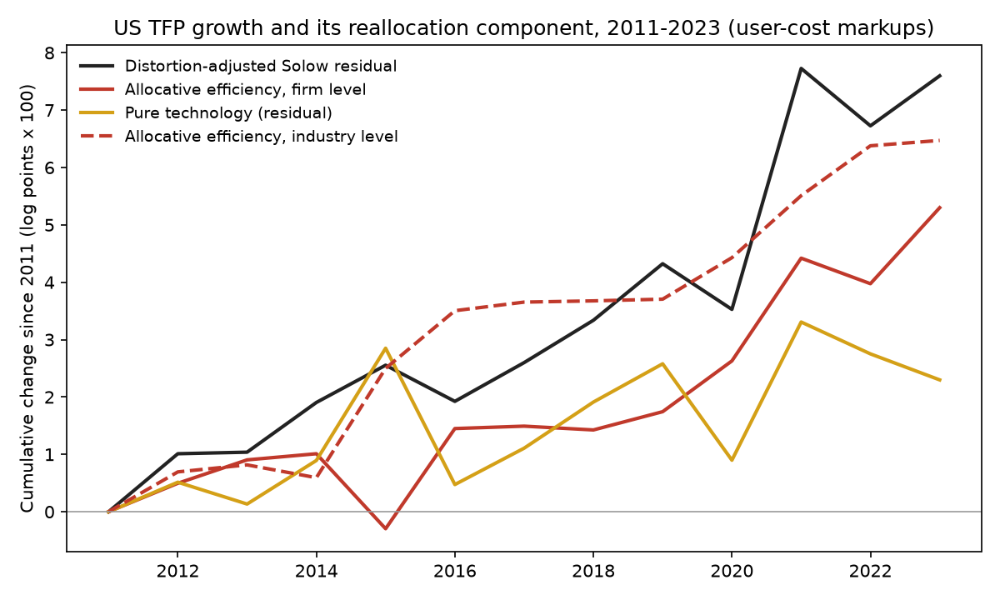
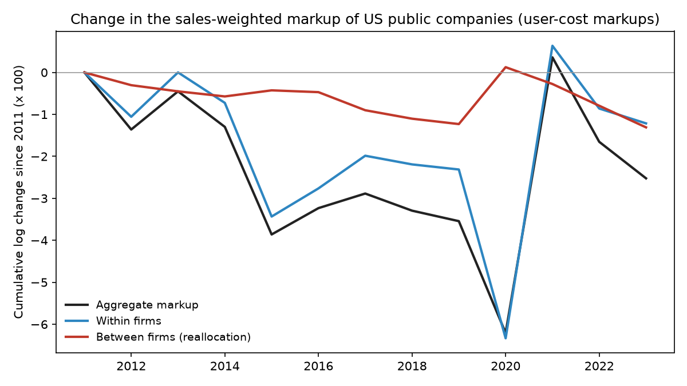

# Too Small to Begin With

### In 2020, David Baqaee and Emmanuel Farhi asked how much of America's productivity growth came from sales moving toward companies with high markups. I asked again with company filings from 2011 to 2023.

---

In 2011 Amazon sold $48 billion of goods and services. By 2023 it sold $575 billion, more than Walmart's entire
2011 revenue, at a price that sat about 4% above its full cost once the warehouses and data centers are charged
for. Apple went from $108 billion to $383 billion over the same years and priced 41% above its cost. Both grew
enormously, Amazon by keeping very little of each sale and Apple by keeping a great deal of it.

In a fully competitive economy that difference would not matter to a measure of national productivity. If every
market were competitive, moving a dollar of spending from one company to another would
change nothing about how efficiently the country uses its workers and machines. Markups break that rule, because a
company that charges far above its cost sells less than a competitive market would have it sell, so every dollar of
business that drifts toward it moves the economy closer to where it should be. Baqaee and Farhi turned that
observation into a precise accounting identity and applied it to American public companies. Their answer was that
about half of US productivity growth between 1997 and 2015 came from exactly this drift.

---

## Markups, and why the spread between them matters

A markup compares a company's price with its cost. With constant returns to scale, marginal cost equals average
cost, so the markup can be read off the income statement once every input, including capital, is counted:

```math
\mu_i = \frac{\text{revenue}_i}{\text{revenue}_i - \text{operating income}_i + r\,K_i},
\qquad
L_i = 1 - \frac{1}{\mu_i}
```

Here $`\mu_i`$ is firm $`i`$'s markup, $`K_i`$ its net property, plant and equipment, $`r`$ the required real return
on capital, and $`L_i`$ the Lerner index, the share of each sales dollar that is pure profit. For Apple's fiscal
2023, with revenue of $383,285 million, operating income of $114,301 million, net plant of $43,715 million and a
required return of 6.28% (the 10-year inflation-protected Treasury yield plus Damodaran's equity risk premium):

```math
\mu_{\text{Apple}} = \frac{383{,}285}{383{,}285 - 114{,}301 + 0.0628 \times 43{,}715}
= \frac{383{,}285}{271{,}729} = 1.41,
\qquad L_{\text{Apple}} = 0.29
```

Three companies show the range.

| Company, 2023 | Markup | Lerner index | What it means |
|---|---|---|---|
| Apple | 1.41 | 0.29 | 29 cents of every dollar is profit beyond the cost of capital |
| Amazon | 1.04 | 0.04 | Priced close to full cost |
| Moderna | 0.61 | −0.64 | Revenue covers only 61% of cost; the firm lost money |

The second measure the reader needs is the Domar weight, a company's sales divided by GDP, written $`\lambda_i`$.
It sums to more than one across the economy because sales to other companies are counted too. Baqaee and Farhi's
central move is to replace it, wherever efficiency is concerned, with a cost-based Domar weight $`\tilde\lambda_i`$
that measures how much of the economy's total cost passes through company $`i`$, directly or as an input to
someone else. In 2023 the 66 private industries in the BEA input-output tables had sales-based weights summing to
1.76 and cost-based weights summing to 1.85, because markups charged further down a supply chain make an upstream
supplier's sales understate its share of the economy's costs.

---

## Baqaee, Farhi and the accounting of misallocation

David Rezza Baqaee earned his doctorate at Harvard and worked at the London School of Economics before joining
UCLA's economics department in 2018. Emmanuel Farhi earned his doctorate at MIT in 2006, joined Harvard's faculty
the same year, and was the Robert C. Waggoner Professor of Economics when he died suddenly in July 2020, at 41.
Their paper, "Productivity and Misallocation in General Equilibrium," appeared in the *Quarterly Journal of
Economics* in 2020, after circulating as a working paper since 2017.

The theory starts with Hulten's theorem, a 1978 result that says a 1% productivity gain at one company raises
national output by that company's sales share. Hulten's theorem holds only if the economy is efficient. Baqaee and
Farhi generalize it to an economy with markups and any network of suppliers. Output growth then splits into a pure
technology effect and a change in allocative efficiency, the part that comes from resources moving between
companies charging different markups.

The simplest case shows why the direction of the movement matters. Suppose one factor of production, labor, and
companies that each sell straight to consumers with constant returns, so firm $`i`$ pays labor $`\lambda_i/\mu_i`$
of GDP and labor's share of GDP is $`\Lambda = \sum_i \lambda_i/\mu_i`$. With no input-output links the
cost-based and sales-based Domar weights coincide, $`\tilde\lambda_i = \lambda_i`$, the sales shares sum to one, and
labor's share of total cost is one. Baqaee and Farhi's Theorem 1 then sets the change in allocative efficiency
equal to $`-\sum_i \lambda_i\, d\log\mu_i - d\log\Lambda`$. Writing $`\bar\mu = 1/\Lambda`$ for the economy's
average markup and differentiating $`\Lambda`$ gives

```math
\begin{aligned}
d\log \Lambda &= \bar\mu \sum_i \left(\frac{d\lambda_i}{\mu_i} - \frac{\lambda_i}{\mu_i}\, d\log\mu_i\right) \\
\Delta \text{AE} &= -\sum_i \lambda_i\, d\log\mu_i - d\log\Lambda \\
 &= -\sum_i \lambda_i \left(1 - \frac{\bar\mu}{\mu_i}\right) d\log\mu_i
 \;-\; \bar\mu \sum_i \frac{d\lambda_i}{\mu_i} \\
 &= -\sum_i \lambda_i \left(1 - \frac{\bar\mu}{\mu_i}\right) d\log\mu_i
 \;+\; \bar\mu \sum_i d\lambda_i\, L_i
\end{aligned}
```

The last line uses the fact that sales shares sum to one, so $`\sum_i d\lambda_i = 0`$ and
$`-\sum_i d\lambda_i/\mu_i = \sum_i d\lambda_i\,(1 - 1/\mu_i)`$. The first term is about companies changing their
own markups. The second is pure reallocation, and in words it says that allocative efficiency improves when sales
shares move toward companies with high Lerner indices, because those companies were producing too little to begin
with.

Applied to Compustat firms placed inside the BEA input-output network, with markups estimated three ways, the
identity told Baqaee and Farhi that "improvement in allocative efficiency, due to the reallocation over time of
market share to high-markup firms, accounts for about half of aggregate TFP growth over the period 1997-2015"
(NBER Working Paper 24007, abstract). When they collapsed each industry into one representative firm, the
contribution of reallocation was "drastically reduced" and even changed sign, so it happened between firms inside
industries. They also estimated that removing all markup
distortions would raise productivity by about 15%, which, as they note, is two orders of magnitude above Arnold
Harberger's famous 0.1% estimate from 1954.

The strongest objection concerns the markups themselves. James Traina and Susanto Basu, among others, have argued
that measured markups depend heavily on which costs are counted. A software company or drug maker spends most of its
money on research, marketing and overhead, so a markup computed from the cost of goods sold alone looks enormous,
while one computed from total cost looks ordinary. If the companies gaining share are the ones whose costs are
hidden below the gross-profit line, the "reallocation toward high markups" may be reallocation toward a particular
cost structure. Baqaee and Farhi themselves wrote that their numbers "should be interpreted with care since the data
is imperfect and requires substantial imputation." The question matters because the answer decides whether the rise
of very large, very profitable companies has been good or bad for the economy's efficiency.

---

## How I tested it

Compustat is licensed, so I built the company data from the SEC's Financial Statement Data Sets, which contain
every number tagged in every 10-K. These begin in 2009 and cover every filer from 2011, which fixes the start of
the window, and the BEA input-output tables end in 2023, which fixes the end. I followed the paper's rules where I
could. Financial companies are excluded, as are firm-years with assets under $10 million or negative book equity.
Markups and their annual changes are winsorized at the 5th and 95th percentiles each year. Companies are assigned to
the 66 BEA summary industries through their SIC codes, and industries without enough public companies take the
economy-wide markup (I required at least three firms whose combined revenue is at least 1% of the industry's gross output). The benchmark markup
is the user-cost version above, with one economy-wide required return instead of the paper's industry risk premia.
Productivity growth comes from John Fernald's business-sector series at the San Francisco Fed, the source the paper
used. The final sample is 35,002 firm-years for 5,602 companies.

For each pair of years I keep the companies present in both, and compute the paper's equation (7):

```math
\Delta \text{AE}_t = -\sum_{i} \tilde\lambda_{i,t-1}\,\Delta\log\mu_{i,t}
 - \sum_{f\in\{L,K\}} \tilde\Lambda_{f,t-1}\,\Delta\log\Lambda_{f,t}
```

```math
\Delta\log \text{TFP}_t = \Delta\log Y_t - \tilde\Lambda_{L,t-1}\Delta\log H_t - \tilde\Lambda_{K,t-1}\Delta\log K_t
```

Here $`\Lambda_f`$ is factor $`f`$'s share of GDP (labor from BEA compensation, capital as gross operating surplus
minus imputed profits), $`\tilde\Lambda_f`$ its share of total cost, $`Y`$ business output, $`H`$ quality-adjusted
hours and $`K`$ capital services. Technology is the residual, $`\Delta\log\text{TFP}_t - \Delta\text{AE}_t`$. Both
series are summed over 2012 to 2023. A 95% interval comes from 200 bootstrap draws that resample whole companies.

To test the mechanism directly, I ask whether companies with higher markups gain market share within their
industry the following year:

```math
\Delta\log s_{i,t} = \alpha_{I(i),t} + \beta\, L_{i,t-1} + \varepsilon_{i,t},
\qquad H_0:\ \beta = 0
```

where $`s_{i,t}`$ is firm $`i`$'s share of its industry's public-company sales, $`\alpha_{I,t}`$ is an
industry-by-year fixed effect and $`L_{i,t-1}`$ last year's Lerner index. The paper's story requires $`\beta > 0`$.
Standard errors are clustered by company, and I estimate the regression both unweighted and weighted by last year's
share. For the extension I recompute everything with markups measured from the cost of goods sold alone, as De
Loecker and Eeckhout do, and from all operating costs, as Traina does, each scaled by its industry's median cost
share.

---

## Reallocation still accounts for most of measured productivity growth

Business-sector productivity, adjusted for markups, grew 7.6 log points between 2011 and 2023. The allocative
efficiency term summed to 5.3 log points.

```math
\sum_{t=2012}^{2023}\Delta\text{AE}_t = 0.053\ \ [0.037,\ 0.069],
\qquad
\frac{\sum \Delta\text{AE}_t}{\sum \Delta\log\text{TFP}_t} = 0.70\ \ [0.49,\ 0.90]
```

That is more than the paper's half. Seventy percent of the period's productivity growth came
from reallocation and only 2.3 log points from technology. Using the paper's simpler accounting-profit markups,
where capital costs nothing beyond depreciation, gives 59%, with an interval of 39% to 83%.



The dashed line in the figure undercuts that reading. When each industry is treated as a single company charging its
average markup, which is the calculation Baqaee and Farhi used to show that their gain came from inside industries,
the allocative-efficiency term is larger, 6.5 log points. In their 1997 to 2015 data the firm-level line sat well
above the industry line. In mine it sits below.

---

## Inside industries, sales moved toward the low-markup companies

The first-order piece of the firm-level calculation that comes from shares shifting within industries is
$`\sum_t \sum_i \tilde\lambda_{I}\,\mu_{I}\,\Delta s_{i,t}\,L_{i,t-1}`$, the network version of the reallocation
term derived above. It summed to −4.2 log points, with a bootstrap interval of −5.8 to −2.9. The regression says the same thing.

| Markup measure | Weights | β | Std. error | p | Firm-years |
|---|---|---|---|---|---|
| User cost | Equal | −0.021 | 0.002 | < 0.001 | 28,708 |
| User cost | Sales share | −0.079 | 0.018 | < 0.001 | 28,708 |
| Accounting profit | Sales share | −0.070 | 0.020 | < 0.001 | 28,708 |

A company whose Lerner index is ten points higher than an industry rival's saw its share grow about 0.8% more
slowly each year, in the sales-weighted version. The aggregate markup tells the same story. The sales-weighted
user-cost markup of US public companies was 1.099 in 2011 and fell 2.5 log points by 2023, 1.2 points from
companies lowering their own markups and 1.3 points from sales shifting toward lower-markup companies. Baqaee and
Farhi's Figure 3 showed the between-company part pushing markups up.



The companies behind these numbers are recognizable.

| Company | BEA industry | Share of industry's public sales, first year → 2023 | Markup, 2023 | Contribution to within-industry term |
|---|---|---|---|---|
| Apple | Computers and electronics | 10% → 29% | 1.41 | +0.09 points |
| Meta | Data processing and internet | 5% → 24% | 1.43 | +0.10 points |
| Amazon | Other retail | 8% → 35% | 1.04 | +0.03 points |
| Tesla | Motor vehicles | 0.05% → 15% | 1.08 | −0.02 points |
| Pfizer | Chemicals | 12% → 7% | 1.00 | −0.09 points |
| Moderna | Chemicals | 0.02% → 0.8% | 0.61 | −0.15 points |
| ConocoPhillips | Petroleum and coal products | 30% → 6% | 1.27 | −0.46 points |

Apple and Meta are the paper's story in miniature, high-markup companies that took share and added to efficiency.
They are outweighed by two other patterns. Money-losing growth companies such as Moderna, Rivian and Exact Sciences
gained share while their measured markups sat below one, which the accounting reads as overproduction. And large
high-markup incumbents lost share, sometimes for reasons that have nothing to do with competition. ConocoPhillips
spun off its refineries as Phillips 66 in 2012, and its fall within the refining industry is the largest single
negative entry in the table. Markups in the table are before winsorizing; the calculation itself caps them at the
95th percentile, about 1.33 in 2023.

---

## Most of the gain is oil prices and money-losing firms

If the within-industry piece is negative, the positive total must come from the industry level, from markups and
factor shares moving across the 66 BEA industries. Much of that is oil. The sales-weighted markup of oil and gas producers
was 1.04 in 2014, 0.43 in 2015, 0.51 in 2020 and 1.33 in 2022, tracking the price of crude, and the identity books
each swing as a change in allocative efficiency. Changing one rule at a time:

| Version | Allocative efficiency, log points | Share of TFP growth | Within-industry term |
|---|---|---|---|
| Paper's rules (benchmark) | 5.3 | 70% | −4.2 |
| Oil, gas and refining take the economy-wide markup | 2.8 | 37% | −3.6 |
| Drop loss-making firm-years | 1.4 | 17% | −0.15 |
| Keep negative-equity firms | 5.9 | 77% | −4.5 |
| Winsorize at 1–99 instead of 5–95 | 9.7 | 127% | −11.7 |

Taking energy companies out of the firm detail cuts the term roughly in half. Dropping loss-making firm-years
cuts it to about a quarter and removes almost all of the negative within-industry reallocation, which says that the
within-industry pattern is mostly about money-losing companies growing. Loosening the winsorizing pushes the answer
past 100% of productivity growth, an implausible result, because firms with markups near zero, which the 5–95
cut would have trimmed, then weigh heavily in the harmonic industry averages.

---

## Measured from cost of goods sold, the paper's mechanism comes back and the total disappears

The extension tests the objection directly. The cost-of-goods markup is the one De Loecker, Eeckhout and Unger
made famous, and it is close to the production-function markups Baqaee and Farhi reported alongside their
benchmark. It needs a COGS line, which 25,591 of the firm-years report.

| Markup measure, same 4,249 companies | Allocative efficiency, log points | Share of TFP growth | Within-industry term |
|---|---|---|---|
| User cost (paper's benchmark) | 0.6 | 8% | −2.6 |
| Accounting profits | −0.2 | −3% | −2.5 |
| Cost of goods sold only (De Loecker–Eeckhout) | 0.2 | 4% | +2.3 |
| All operating costs (Traina) | 0.1 | 2% | −1.6 |

Two things happen. On the COGS-reporting companies, which leave out most railroads, airlines, hotels, utilities,
oil producers and telecom companies, every version of the total falls below 10% of productivity growth. And only the COGS-only markup produces
the paper's within-industry mechanism. Its regression coefficient turns positive, 0.023 with a standard error of
0.008 in the sales-weighted version, because companies whose costs sit mostly in SG&A and research (software,
drugs, branded goods) look like high-markup firms under that measure, and those companies grew. Count all operating
costs, as Traina does, and the coefficient is 0.006 with a standard error of 0.015, indistinguishable from zero.

---

## Why it matters

For consumers, the result removes one reason to be relaxed about large, profitable companies. The paper's finding
implied that the growth of high-markup firms had been quietly raising productivity, so that their market power came
with a hidden dividend. In 2011 to 2023 the companies that grew fastest within their industries were, on
average, the ones charging less above cost.

For workers, allocative efficiency is about where labor and capital end up. The data show sales moving toward
companies like Amazon, Costco and CVS, which price close to cost, and toward money-losing firms that investors
were funding. By Baqaee and Farhi's accounting the first adds almost nothing to measured efficiency (Amazon's
contribution is +0.03 points) and the second subtracts from it, although losses that are really spending on research
or new capacity would read differently once that spending is counted as investment.

For smaller firms, the regression's negative coefficient is a reminder that high margins do not guarantee growth.
Within an industry, the fast growers of the 2010s were usually not its most profitable members.

For policy, the result is a caution about using one decomposition to settle a question about market power. The
same identity, applied to the same filings, gives 70% or 2% of productivity growth depending on which costs are
counted, whether energy is in the sample and how the tails are trimmed. Baqaee and Farhi's framework is a sound
way to think about markups and efficiency. The measurements that feed it are not yet good enough to say how much
reallocation has helped.

---

## Limits of this study

The SEC data cover only public companies and only those whose filings use standard tags; some large filers, such as
ExxonMobil before 2018, used custom revenue tags and drop out of those years. Company revenue includes foreign
sales, while the BEA tables measure US production. The firm-level input-output network is imputed from industry
tables by assuming every company in an industry has the same cost structure, as the paper does. My user cost uses
one required return for every company, where the paper used industry-specific risk premia, and the industry
coverage rule is my own judgment. Accounting losses treat research and advertising as current costs, so a growing
biotech or electric-vehicle maker looks like a firm pricing below cost even when it is investing. The window is 13
years, against the paper's 18, and contains a pandemic and an energy shock. And the decomposition is a first-order
accounting identity with technology measured as a residual, so it describes where measured growth came from and
does not establish what caused it.

---

## Further reading

- [TECHNICAL.md](TECHNICAL.md) has the data, rules, every test statistic, and how to reproduce the results.
- [results/FINDINGS.md](results/FINDINGS.md) has a plain-English summary and every table the scripts produce.
- [METHODS_REVIEW.md](METHODS_REVIEW.md) is a methods and statistical-reporting review of the original paper.
- David Rezza Baqaee and Emmanuel Farhi, "Productivity and Misallocation in General Equilibrium," *Quarterly
  Journal of Economics* 135(1), 2020, pp. 105–163; NBER Working Paper 24007.
- SEC Financial Statement Data Sets, 2012q1–2025q3, sec.gov/dera/data/financial-statement-data-sets.
- BEA, Use of Commodities by Industries, Before Redefinitions, Summary, 1997–2023, apps.bea.gov/industry.
- John Fernald, Quarterly (and annual) TFP series for the US business sector, Federal Reserve Bank of San
  Francisco, release of October 2026.
- FRED series DFII10 (10-year TIPS yield) and Aswath Damodaran's implied equity risk premiums (histimpl.xls).

*Brendyn Beasley*
