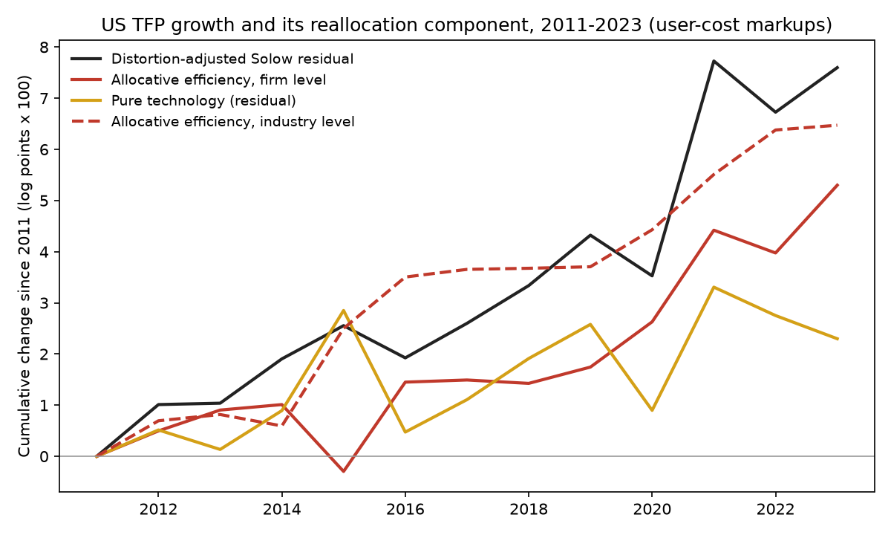
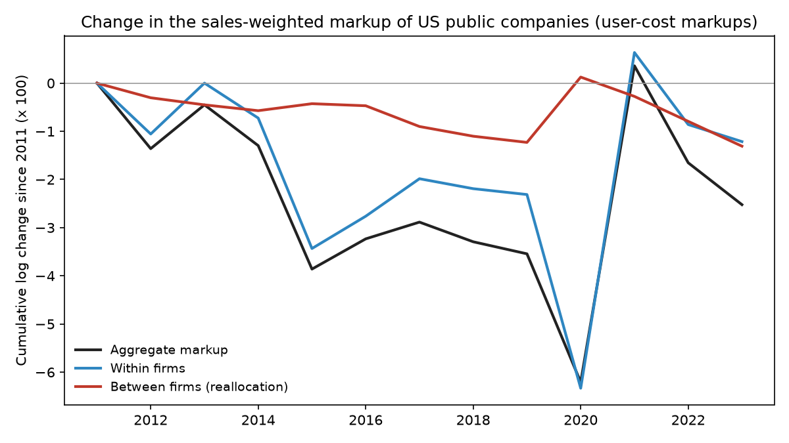

# Baqaee and Farhi (2020) on 2011–2023 filings: findings

## In plain English

Baqaee and Farhi found that about half of US productivity growth from 1997 to 2015 came from sales moving toward
companies with high markups, inside their industries. This repository reruns their accounting on SEC filings for
2011 to 2023.

- **The headline share survives, the mechanism does not.** The allocative-efficiency term is 70% of markup-adjusted
  productivity growth (bootstrap interval 49% to 90%), but treating each industry as one firm gives an even larger
  number, so the gain is not coming from inside industries.
- **Inside industries, sales moved toward low-markup companies.** Apple and Meta gained share at high markups, as
  the paper's story requires, but Amazon, Costco and CVS grew at markups between 1.03 and 1.04, and money-losing growth firms
  such as Moderna, Rivian and Exact Sciences gained share at markups below one. Companies with higher markups grew
  more slowly than their industry rivals the following year.
- **Much of the total is oil prices and money-losing firms.** Giving oil, gas and refining the economy-wide markup
  cuts the share to 37%; dropping loss-making firm-years cuts it to 17%.
- **The paper's mechanism reappears only with cost-of-goods markups.** Measured from COGS alone, as De Loecker and
  Eeckhout do, high-markup firms gain share; measured from all operating costs, as Traina does, they do not, and on
  the companies that report COGS the total falls below 10% of productivity growth under every markup measure.

A friendlier tour is in the [README](../README.md). The rest of this page is the technical detail.

**Key to the labels below.** *AE* = allocative efficiency, the paper's equation (7), cumulated 2012–2023 in log
points (0.053 = 5.3 log points). *TFP* = distortion-adjusted Solow residual, business sector (Fernald), cumulated.
*AE industry* = the same calculation with each BEA industry treated as one firm (the paper's Figure 5).
*Within* = the first-order within-industry reallocation term, sum over firms and years of cost-based Domar weight
times industry markup times change in within-industry share times last year's Lerner index. *Share* = AE / TFP.
*User cost* markup = revenue / (revenue − operating income + r × net PP&E), r = 10-year TIPS yield + Damodaran
implied equity premium. *Accounting profits* = revenue / (revenue − operating income). *COGS* and *All operating
costs* = industry-year median cost share × revenue / that cost. Markup columns marked raw are before the paper's
5–95% winsorizing. BEA codes: 211 oil and gas extraction, 324 petroleum and coal products, 334 computer and
electronic products, 4A0 other retail, 514 data processing and internet publishing, 325 chemicals, 452 general
merchandise stores, 3361MV motor vehicles.

## Main results by markup series (`summary.csv`)

| Markup series | Firms | TFP | AE firm | AE industry | Within | AE share |
|---|---|---|---|---|---|---|
| User cost (paper's benchmark) | 5602 | 0.0760 | 0.0530 | 0.0647 | −0.0422 | 0.70 |
| Accounting profits | 5602 | 0.0789 | 0.0468 | 0.0640 | −0.0401 | 0.59 |
| COGS cost share (De Loecker-Eeckhout style) | 4249 | 0.0625 | 0.0022 | 0.0137 | 0.0235 | 0.04 |
| All operating costs, cost share (Traina style) | 4249 | 0.0767 | 0.0014 | 0.0241 | −0.0161 | 0.02 |
| User cost (paper's benchmark), COGS reporters only | 4249 | 0.0760 | 0.0058 | 0.0281 | −0.0260 | 0.08 |
| Accounting profits, COGS reporters only | 4249 | 0.0785 | −0.0022 | 0.0238 | −0.0247 | −0.03 |

Bootstrap 95% intervals, 200 company resamples (`summary.csv`):

| Series | AE lo | AE hi | AE ind. lo | AE ind. hi | Share lo | Share hi | Within lo | Within hi |
|---|---|---|---|---|---|---|---|---|
| User cost (paper's benchmark) | 0.0374 | 0.0686 | 0.0554 | 0.0833 | 0.4899 | 0.8987 | −0.0584 | −0.0287 |
| Accounting profits | 0.0305 | 0.0655 | 0.0521 | 0.0869 | 0.3889 | 0.8276 | −0.0567 | −0.0264 |

## Year by year, user-cost markups (`decomposition.csv`)

Factor shares and cost-based labor share are at the start of each step. *markup_term* and *factor_term* are the two
pieces of equation (7); they are large and offsetting, and AE is their sum. *technology* = TFP − AE.

| year | tfp_adjusted | tfp_fernald | ae_firm | ae_industry | markup_term | factor_term | technology | Lt_labor | Lambda_labor | Lambda_capital | firms |
|---|---|---|---|---|---|---|---|---|---|---|---|
| 2012 | 0.0101 | 0.0098 | 0.0050 | 0.0069 | 0.0207 | −0.0157 | 0.0051 | 0.5702 | 0.4852 | 0.3618 | 2458 |
| 2013 | 0.0003 | 0.0004 | 0.0041 | 0.0012 | −0.0147 | 0.0187 | −0.0038 | 0.5693 | 0.4876 | 0.3691 | 2408 |
| 2014 | 0.0087 | 0.0087 | 0.0011 | −0.0022 | 0.0239 | −0.0229 | 0.0076 | 0.5777 | 0.4838 | 0.3555 | 2410 |
| 2015 | 0.0065 | 0.0067 | −0.0131 | 0.0191 | 0.0425 | −0.0556 | 0.0196 | 0.5706 | 0.4871 | 0.3690 | 2350 |
| 2016 | −0.0063 | −0.0056 | 0.0175 | 0.0100 | −0.0046 | 0.0221 | −0.0238 | 0.5554 | 0.4930 | 0.4149 | 2239 |
| 2017 | 0.0068 | 0.0073 | 0.0004 | 0.0015 | −0.0061 | 0.0065 | 0.0063 | 0.5654 | 0.4929 | 0.3935 | 2199 |
| 2018 | 0.0074 | 0.0077 | −0.0007 | 0.0002 | 0.0098 | −0.0104 | 0.0080 | 0.5714 | 0.4954 | 0.3805 | 2355 |
| 2019 | 0.0099 | 0.0109 | 0.0032 | 0.0003 | 0.0089 | −0.0057 | 0.0067 | 0.5616 | 0.4947 | 0.3974 | 2359 |
| 2020 | −0.0080 | −0.0023 | 0.0088 | 0.0072 | 0.0467 | −0.0378 | −0.0168 | 0.5578 | 0.4964 | 0.4003 | 2354 |
| 2021 | 0.0420 | 0.0409 | 0.0179 | 0.0108 | −0.0942 | 0.1121 | 0.0241 | 0.5543 | 0.5076 | 0.4272 | 2508 |
| 2022 | −0.0100 | −0.0099 | −0.0045 | 0.0087 | 0.0382 | −0.0427 | −0.0056 | 0.5978 | 0.4964 | 0.3416 | 2611 |
| 2023 | 0.0087 | 0.0091 | 0.0132 | 0.0009 | 0.0172 | −0.0040 | −0.0045 | 0.5605 | 0.4847 | 0.3842 | 2457 |

## Aggregate markup, within and between firms (`markup_between_within.csv`)

The paper's Figure 3: change in the harmonic sales-weighted user-cost markup across continuing companies, split
into firms changing their own markups (within) and sales shifting between firms (between).

| year | markup_start | dlog_markup | within | between | cum_dlog_markup | cum_within | cum_between |
|---|---|---|---|---|---|---|---|
| 2012 | 1.0989 | −0.0136 | −0.0106 | −0.0030 | −0.0136 | −0.0106 | −0.0030 |
| 2013 | 1.0866 | 0.0091 | 0.0106 | −0.0015 | −0.0045 | 0.0000 | −0.0045 |
| 2014 | 1.0974 | −0.0085 | −0.0073 | −0.0012 | −0.0130 | −0.0073 | −0.0057 |
| 2015 | 1.0895 | −0.0256 | −0.0271 | 0.0014 | −0.0386 | −0.0343 | −0.0043 |
| 2016 | 1.0650 | 0.0063 | 0.0067 | −0.0004 | −0.0323 | −0.0276 | −0.0047 |
| 2017 | 1.0730 | 0.0035 | 0.0078 | −0.0043 | −0.0289 | −0.0198 | −0.0090 |
| 2018 | 1.0746 | −0.0041 | −0.0021 | −0.0020 | −0.0329 | −0.0219 | −0.0110 |
| 2019 | 1.0685 | −0.0025 | −0.0012 | −0.0013 | −0.0354 | −0.0231 | −0.0123 |
| 2020 | 1.0688 | −0.0266 | −0.0402 | 0.0136 | −0.0621 | −0.0633 | 0.0013 |
| 2021 | 1.0405 | 0.0657 | 0.0697 | −0.0040 | 0.0036 | 0.0063 | −0.0028 |
| 2022 | 1.1117 | −0.0201 | −0.0149 | −0.0052 | −0.0165 | −0.0086 | −0.0079 |
| 2023 | 1.0939 | −0.0087 | −0.0035 | −0.0052 | −0.0252 | −0.0121 | −0.0131 |

## Do high-markup firms gain share? (`share_regression.csv`)

Change in log within-industry share on last year's Lerner index, industry-by-year fixed effects, standard errors
clustered by company. *mu_uc* user cost, *mu_ap* accounting profits, *mu_cogs* COGS cost share, *mu_opex* all
operating costs cost share.

| series | weights | beta | se | ci_low | ci_high | p | n | firms |
|---|---|---|---|---|---|---|---|---|
| mu_uc | equal-weighted | −0.0209 | 0.0017 | −0.0242 | −0.0176 | 0.0000 | 28708 | 4885 |
| mu_uc | sales-weighted | −0.0790 | 0.0182 | −0.1147 | −0.0433 | 0.0000 | 28708 | 4885 |
| mu_ap | equal-weighted | −0.0208 | 0.0017 | −0.0241 | −0.0175 | 0.0000 | 28708 | 4885 |
| mu_ap | sales-weighted | −0.0699 | 0.0199 | −0.1088 | −0.0310 | 0.0004 | 28708 | 4885 |
| mu_cogs | equal-weighted | 0.0269 | 0.0054 | 0.0162 | 0.0375 | 0.0000 | 21244 | 3707 |
| mu_cogs | sales-weighted | 0.0228 | 0.0079 | 0.0073 | 0.0383 | 0.0039 | 21244 | 3707 |
| mu_opex | equal-weighted | −0.0459 | 0.0039 | −0.0536 | −0.0382 | 0.0000 | 21244 | 3707 |
| mu_opex | sales-weighted | 0.0065 | 0.0154 | −0.0238 | 0.0367 | 0.6744 | 21244 | 3707 |

## Robustness, user-cost markups (`robustness.csv`)

One rule changed at a time. *cum_between* is the between-firm part of the aggregate markup change.

| variant | firm_years | cum_tfp_adjusted | cum_ae_firm | cum_ae_industry | within_realloc | cum_between | share_ae_of_tfp |
|---|---|---|---|---|---|---|---|
| Paper's rules (benchmark) | 35002 | 0.0760 | 0.0530 | 0.0647 | −0.0422 | −0.0131 | 0.70 |
| Winsorize at 1-99 instead of 5-95 | 35002 | 0.0766 | 0.0971 | 0.0710 | −0.1171 | −0.0173 | 1.27 |
| Keep negative-equity firms | 41846 | 0.0765 | 0.0592 | 0.0659 | −0.0445 | −0.0187 | 0.77 |
| Drop loss-making firm-years | 22190 | 0.0801 | 0.0137 | 0.0109 | −0.0015 | 0.0043 | 0.17 |
| Oil, gas and refining take the aggregate markup | 33448 | 0.0762 | 0.0280 | 0.0198 | −0.0364 | −0.0077 | 0.37 |

## Well-known companies (`names.csv`)

Revenue, operating income and user cost in $ millions for the last year; shares are of the BEA industry's
public-company sales; *contrib* is the company's summed contribution to the within-industry term.

| name | bea | first_year | revenue_first | revenue_last | op_income_last | user_cost_last | markup_raw_last | lerner_raw_last | markup_last | share_first | share_last | contrib |
|---|---|---|---|---|---|---|---|---|---|---|---|---|
| Apple | 334 | 2011 | 108,249 | 383,285 | 114,301 | 2,745 | 1.411 | 0.291 | 1.328 | 0.103 | 0.289 | 0.00091 |
| Microsoft | 511 | 2011 | 69,943 | 211,915 | 88,523 | 6,006 | 1.638 | 0.389 | 1.328 | 0.376 | 0.397 | 0.00018 |
| Alphabet | 514 | 2014 | 66,001 | 307,394 | 84,293 | 8,437 | 1.328 | 0.247 | 1.328 | 0.339 | 0.556 | 0.00017 |
| Meta | 514 | 2011 | 3,711 | 134,902 | 46,751 | 6,066 | 1.432 | 0.302 | 1.328 | 0.052 | 0.244 | 0.00101 |
| Nvidia | 334 | 2011 | 3,998 | 60,922 | 32,972 | 246 | 2.161 | 0.537 | 1.328 | 0.004 | 0.046 | 0.00017 |
| Amazon | 4A0 | 2011 | 48,077 | 574,785 | 36,852 | 12,822 | 1.044 | 0.042 | 1.044 | 0.079 | 0.346 | 0.00033 |
| Walmart | 452 | 2011 | 446,950 | 648,125 | 27,012 | 6,959 | 1.032 | 0.031 | 1.032 | 0.583 | 0.561 | −0.00003 |
| Costco | 452 | 2011 | 88,915 | 242,290 | 8,114 | 1,676 | 1.027 | 0.027 | 1.027 | 0.116 | 0.210 | 0.00003 |
| CVS Health | 4A0 | 2013 | 126,761 | 357,776 | 13,743 | 828 | 1.037 | 0.036 | 1.037 | 0.149 | 0.215 | −0.00000 |
| Tesla | 3361MV | 2011 | 204 | 96,773 | 8,891 | 1,867 | 1.078 | 0.073 | 1.078 | 0.000 | 0.149 | −0.00022 |
| General Motors | 3361MV | 2011 | 150,276 | 171,842 | 9,298 | 0 | 1.057 | 0.054 | 1.057 | 0.351 | 0.265 | −0.00003 |
| Pfizer | 325 | 2011 | 67,425 | 58,496 | 1,058 | 1,189 | 0.998 | −0.002 | 0.998 | 0.121 | 0.066 | −0.00089 |
| Moderna | 325 | 2018 | 135 | 6,848 | −4,239 | 122 | 0.611 | −0.637 | 0.611 | 0.000 | 0.008 | −0.00146 |
| ConocoPhillips | 324 | 2011 | 244,813 | 56,141 | 16,288 | 4,399 | 1.269 | 0.212 | 1.269 | 0.304 | 0.056 | −0.00464 |

## Largest positive and negative contributors to the within-industry term (`contributors.csv`)

| entity | bea | markup_mean | years | contrib |
|---|---|---|---|---|
| LENNAR CORP /NEW/ | 23 | 1.141 | 12 | 0.00144 |
| CHEVRON CORP | 324 | 1.061 | 12 | 0.00139 |
| ENVISION HEALTHCARE CORP | 621 | 1.143 | 2 | 0.00116 |
| META PLATFORMS, INC. | 514 | 1.311 | 12 | 0.00101 |
| FIDELITY NATIONAL INFORMATION SERVICES, INC. | 561 | 1.038 | 6 | 0.00093 |
| APPLE INC | 334 | 1.343 | 12 | 0.00091 |
| AMSURG CORP | 621 | 1.326 | 2 | 0.00083 |
| NETFLIX INC | 532RL | 1.126 | 12 | 0.00068 |
| CHICAGO BRIDGE & IRON CO N V | 23 | 1.030 | 6 | 0.00068 |
| HORTON D R INC /DE/ | 23 | 1.189 | 6 | 0.00067 |
| INVITAE CORP | 621 | 0.341 | 7 | −0.00114 |
| H&R BLOCK INC | 81 | 1.235 | 8 | −0.00114 |
| OMNICOM GROUP INC. | 5412OP | 1.151 | 12 | −0.00120 |
| TIMKEN CO | 333 | 1.042 | 12 | −0.00139 |
| MODERNA, INC. | 325 | 0.707 | 5 | −0.00146 |
| XWELL, INC. | 81 | 0.528 | 9 | −0.00171 |
| EXACT SCIENCES CORP | 621 | 0.550 | 12 | −0.00214 |
| RIVIAN AUTOMOTIVE, INC. / DE | 3361MV | 0.224 | 2 | −0.00219 |
| QUEST DIAGNOSTICS INC | 621 | 1.189 | 12 | −0.00236 |
| CONOCOPHILLIPS | 324 | 1.098 | 10 | −0.00464 |

## Industries, 2023 (`industries.csv`)

The 20 BEA industries with the largest cost-based Domar weights. Uncovered industries (fewer than three filers or
filer revenue under 1% of gross output, including housing and finance) take the aggregate markup.

| bea | industry | firms | covered | markup | sales_share | cost_domar | top_firm |
|---|---|---|---|---|---|---|---|
| 42 | Wholesale trade | 84 | True | 1.034 | 0.1154 | 0.1215 | CENCORA, INC. |
| HS | Housing | 0 | False | 1.082 | 0.1189 | 0.1169 | nan |
| 5412OP | Miscellaneous professional, scientific, and technical services | 63 | True | 1.100 | 0.0872 | 0.0962 | OMNICOM GROUP INC. |
| 23 | Construction | 42 | True | 1.103 | 0.0949 | 0.0947 | HORTON D R INC /DE/ |
| ORE | Other real estate | 0 | False | 1.082 | 0.0800 | 0.0881 | nan |
| 4A0 | Other retail | 86 | True | 1.048 | 0.0641 | 0.0638 | AMAZON COM INC |
| 524 | Insurance carriers and related activities | 0 | False | 1.082 | 0.0560 | 0.0616 | nan |
| 561 | Administrative and support services | 126 | True | 1.118 | 0.0539 | 0.0606 | ACCENTURE PLC |
| 521CI | Federal Reserve banks, credit intermediation, and related activities | 0 | False | 1.082 | 0.0557 | 0.0598 | nan |
| 621 | Ambulatory health care services | 55 | True | 1.001 | 0.0599 | 0.0590 | LABORATORY CORP OF AMERICA HOLDINGS |
| 722 | Food services and drinking places | 36 | True | 1.082 | 0.0527 | 0.0535 | ARAMARK |
| 311FT | Food and beverage and tobacco products | 74 | True | 1.116 | 0.0479 | 0.0493 | PEPSICO INC |
| 622 | Hospitals | 7 | True | 1.083 | 0.0472 | 0.0464 | TENET HEALTHCARE CORP |
| 325 | Chemical products | 399 | True | 1.069 | 0.0418 | 0.0460 | MERCK & CO., INC. |
| 81 | Other services, except government | 13 | True | 1.067 | 0.0413 | 0.0423 | SERVICE CORP INTERNATIONAL |
| 513 | Broadcasting and telecommunications | 58 | True | 1.057 | 0.0381 | 0.0391 | COMCAST CORP |
| 55 | Management of companies and enterprises | 0 | False | 1.082 | 0.0319 | 0.0360 | nan |
| 523 | Securities, commodity contracts, and investments | 0 | False | 1.082 | 0.0336 | 0.0355 | nan |
| 514 | Data processing, internet publishing, and other information services | 77 | True | 1.251 | 0.0319 | 0.0336 | ALPHABET INC. |
| 3361MV | Motor vehicles, bodies and trailers, and parts | 52 | True | 1.039 | 0.0316 | 0.0327 | FORD MOTOR CO |

Industry markups by year for five industries (`industries.csv`):

| year | 211 | 324 | 334 | 4A0 | 514 |
|---|---|---|---|---|---|
| 2011 | 1.098 | 1.163 | 1.150 | 1.056 | 1.260 |
| 2012 | 1.058 | 1.125 | 1.134 | 1.051 | 1.228 |
| 2013 | 1.060 | 1.103 | 1.164 | 1.060 | 1.196 |
| 2014 | 1.041 | 1.067 | 1.162 | 1.057 | 1.226 |
| 2015 | 0.433 | 0.938 | 1.147 | 1.058 | 1.199 |
| 2016 | 0.634 | 0.903 | 1.144 | 1.061 | 1.215 |
| 2017 | 0.925 | 0.982 | 1.160 | 1.054 | 1.176 |
| 2018 | 1.028 | 1.049 | 1.198 | 1.039 | 1.174 |
| 2019 | 0.830 | 1.024 | 1.189 | 1.045 | 1.146 |
| 2020 | 0.513 | 0.857 | 1.165 | 1.052 | 1.198 |
| 2021 | 1.148 | 1.068 | 1.236 | 1.051 | 1.288 |
| 2022 | 1.331 | 1.166 | 1.195 | 1.036 | 1.201 |
| 2023 | 1.185 | 1.113 | 1.165 | 1.048 | 1.251 |

Sum of sales-based and cost-based Domar weights, and covered industries (`industries.csv`):

| year | sales_share | cost_domar | covered |
|---|---|---|---|
| 2011 | 1.834 | 1.972 | 52 |
| 2012 | 1.834 | 1.948 | 52 |
| 2013 | 1.838 | 1.976 | 52 |
| 2014 | 1.846 | 1.965 | 53 |
| 2015 | 1.797 | 1.874 | 52 |
| 2016 | 1.782 | 1.862 | 52 |
| 2017 | 1.791 | 1.881 | 53 |
| 2018 | 1.799 | 1.873 | 53 |
| 2019 | 1.773 | 1.836 | 52 |
| 2020 | 1.740 | 1.780 | 52 |
| 2021 | 1.784 | 1.922 | 52 |
| 2022 | 1.809 | 1.923 | 51 |
| 2023 | 1.759 | 1.853 | 50 |

## Figures

